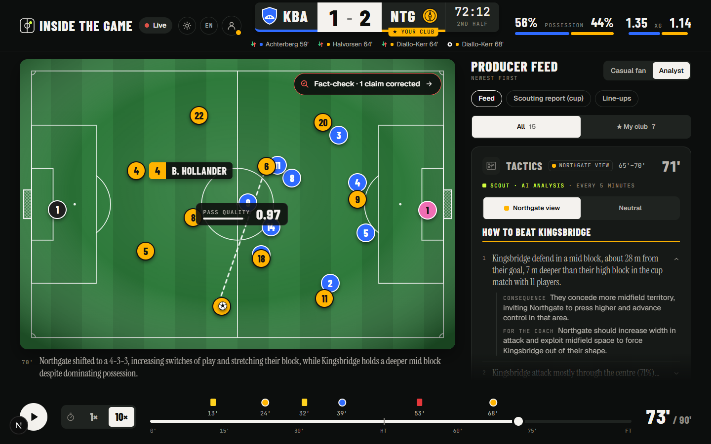
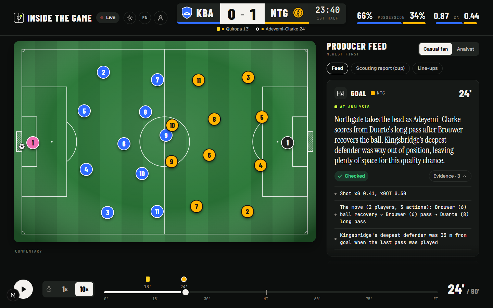
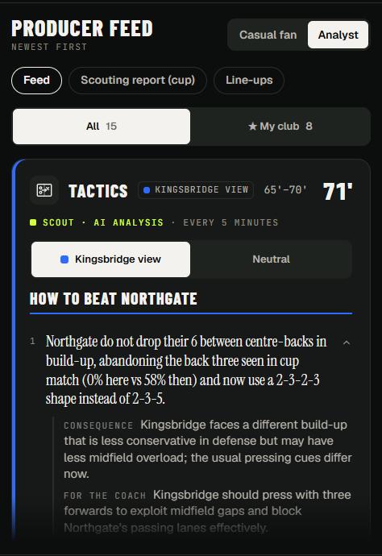
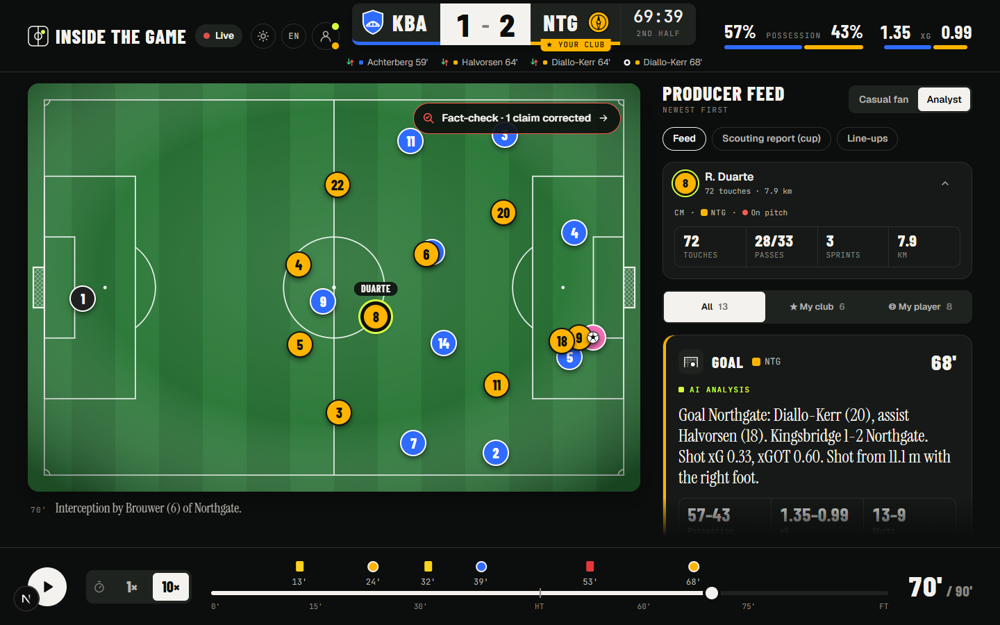
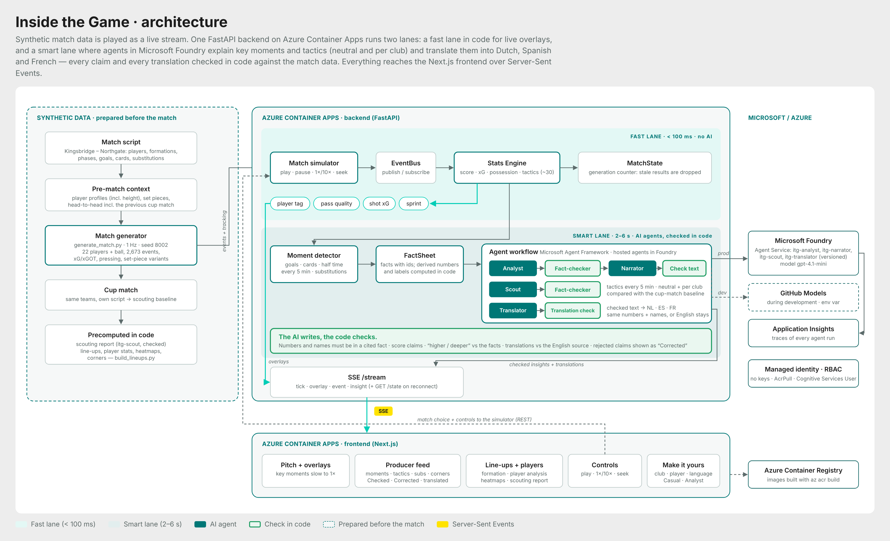
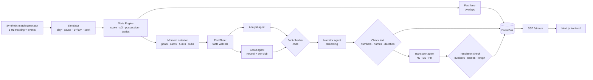

# Inside the Game

### Your football analyst, in your pocket, and it never makes up a number.

Inside the Game sits next to the match and tells you *why* things happen, as they happen. It explains a goal in plain words, reads the tactics like a coach, follows your favourite player across the pitch, and speaks your language. Every claim is checked against the match data before you see it.



**[▶ Open the live demo](https://itg-frontend.kindriver-dc99ee94.westeurope.azurecontainerapps.io)** (no login) · **[Watch the 2-minute video](https://youtu.be/2lWViPzLlEo)**

Built for the **Inside the Game Developer Hackathon (Microsoft × Premier League)** by Serena van Ooijen, Bryan van Ooijen and Edwin Poot.

> All clubs, players and match data are synthetic. No real teams, players or broadcast data are used.

---

## Why we built it

We're a football family. We watch together, and we argue together. Why did that goal happen? Why is our team suddenly so deep? Did that substitution change anything?

The answers usually exist, buried in the data. Stats apps give you numbers without meaning. Generative AI gives you meaning, but sometimes it simply makes things up. And one wrong number is enough to stop trusting everything else on the screen.

So we built a match companion that explains the game like a good analyst does, and **proves every claim**.

## A match with Inside the Game

**Kingsbridge Athletic vs Northgate Rovers.** It ends 2-2, with a red card, five substitutions and ten corners.

**Before kick-off.** You open the scouting report. These two teams met in the cup not long ago. Kingsbridge defended in a high block; Northgate now and then went long from the back. Now you know what to look out for.

**24' — Goal Northgate.** The match slows down. A card appears and the explanation writes itself, word by word: Duarte plays a long pass and Adeyemi-Clarke finishes from 10.9 metres. Next to it a green **Checked**. Click **Evidence** and you see the exact facts behind every sentence.



**15' — The Scout reads the tactics.** *"Kingsbridge defend in a high block, 8 metres higher than in the cup match. That leaves space behind their back line. For the coach: play balls over the top."* Every five minutes, a new analysis, each one compared with the previous meeting: same plan, or something changed?

**46' — Substitutions.** A card tells you what the new player brings and what to watch. Eight minutes later, a second card tells you whether it worked.

**53' — Red card for Brannigan.** Kingsbridge drop from 4-3-3 to 4-4-1, and you see the new shape on the line-up.

**Corners.** Every corner gets its own card: who stands at the near post, who at the far post, how tall they are, where the ball went and what came of it.

**And whenever you're curious,** you click a player. Touches, passes, sprints, distance, a heatmap and his key moments, all updating live.

## Make it yours

### Your club

Pick Kingsbridge or Northgate. Your club gets its own colour in the feed and a "★ YOUR CLUB" tab on the scoreboard. A filter shows only your club's moments. The opponent never disappears, it just steps back a little.

### How to beat them

Switch to the Analyst view, and the tactics turn towards your club:

- **How to beat {opponent}:** what they do, what it means, and what your coach could do about it.
- **What {opponent} changed today:** compared with the cup match, labelled *Changed* or *Same*.

The neutral card is one click away, and both versions rest on exactly the same facts.



### Your player

Follow one player for the whole match (**player focus mode**):

- a ring and a name label follow him across the pitch;
- a strip in the feed shows his touches, passes, sprints and distance as they happen;
- the "My player" filter shows every moment he's part of.

Substituted, sent off, or still on the bench? The strip knows, and offers to follow the substitute.



### Your language

English, Dutch, Spanish or French. Every card is translated, and every translation is checked again.

### Your level

- **Casual fan:** short, clear explanations.
- **Analyst:** the full tactical depth, corner summaries and the scouting comparison.

Nothing to set up: everyone starts neutral, and your choices are remembered on your device.

## Why you can trust it

This is the heart of Inside the Game: **the AI writes, the code checks.**

Before any AI text reaches the screen, code compares every number and every name with the facts computed from the match. A claim that doesn't match is removed. You always see what happened:

| Label | What it means |
| --- | --- |
| **Checked** | Every number and name was found in the match data. |
| **Corrected** | The AI said something the data doesn't support. It was removed before you saw it, and the card tells you what and why. |
| **Fallback** | The AI was too slow. You get a short, safe text built straight from the facts. |
| **translated · checked** | The translation contains exactly the same numbers and names as the checked English text. Click to see the original. |
| **EN** | A translation didn't pass the check or came too late, so you see the English. |

Even the tactics are grounded. The Scout knows about 30 tactical concepts, from a 6 dropping between the centre-backs to a counter-press after losing the ball. But it may only mention a concept when the code has actually measured it in the tracking data.

## Try it in 3 minutes

1. Open the [live demo](https://itg-frontend.kindriver-dc99ee94.westeurope.azurecontainerapps.io) and click **Watch**.
2. Set the speed to **10×**. At **24'** the match slows down for the first goal. Read the card and click **Evidence**.
3. Switch to **Analyst**. Open the **Scouting report** tab, then scroll through the tactical cards in the feed.
4. Open the **profile menu** next to the language picker. Choose **Northgate** as your club and **Duarte** as your player. Watch the ring on the pitch, the strip in the feed, and the next tactical card: **How to beat Kingsbridge**.
5. Pick **FR** in the header. After a few seconds the cards switch to French, marked **translated · checked**.
6. Open **Line-ups**, click any player and look at his heatmap. Jump to **42'** for a corner card.
7. Choose **Reset to Neutral** to start fresh.

The demo plays one shared match. If someone else is watching at the same time, you may see their play, pause or seek.

## Who it's for

- **Fans** who want to understand the game, not just follow the score.
- **Club analysts and coaches** who want a live read on the opponent, compared with the last meeting.
- **Broadcasters** who want insights they can put on air without fear of a wrong number.

---

## Built on Microsoft

Five AI agents work together on **Microsoft Foundry**, and code checks each step.

| Agent | Role |
| --- | --- |
| **Analyst** | Picks the 2–3 facts that explain a moment, and cites them |
| **Narrator** | Turns them into a few sentences for fans, streamed word by word |
| **Scout** | Reads the tactics every 5 minutes, per club and neutral, against the cup baseline |
| **Translator** | Translates checked text into Dutch, Spanish and French |
| **Fact-checker** | Plain code, not an agent: checks numbers, names, score claims, directions and translations |

| Technology | How we use it |
| --- | --- |
| **Microsoft Foundry Agent Service** | Hosted, versioned agents: `itg-analyst`, `itg-narrator`, `itg-scout` and `itg-translator` |
| **Microsoft Foundry models** | `gpt-4.1-mini` (Global Standard) for all agents |
| **Microsoft Agent Framework (Python)** | The workflow. The same code runs code-defined and hosted agents, so we compared both like for like. |
| **Azure Container Apps** | The backend (FastAPI, live stream over SSE) and the frontend (Next.js) |
| **Azure Container Registry** | Images built in the cloud with `az acr build` |
| **Managed identity + Azure RBAC** | No keys anywhere: the backend calls Foundry with its own identity |
| **Application Insights** | Traces of every agent call in Foundry |
| **GitHub Models** | A free model provider during development |

### The numbers

- **8/8** test moments checked, **≈ 4 s** from goal to explanation (p95 ≈ 5 s), **≈ 550 tokens** per moment.
- Translations arrive **1.5–2.6 s** after the English card, which itself doesn't get slower.
- Tactics per club: **12/12** variants checked in our test run, arriving **3–4 s** after the neutral card.

## How it works



Two lanes run side by side:

- **Fast lane** (code, < 100 ms): pitch overlays such as player tags, pass quality, shot xG and sprint speed.
- **Smart lane** (agents, 2–6 s): explanations, tactics, substitutions, the scouting report, commentary and translations.

The flow:

1. **Facts first.** The Stats Engine turns events and tracking into a short list of facts with ids, such as `F3: Diallo-Kerr came on at 64', 4 minutes before this goal`. Differences, counts and labels like "low block" are computed in code, never by the model.
2. **The Analyst** picks claims and cites the fact ids behind each one. **The fact-checker** rejects any claim whose numbers aren't in those facts.
3. **The Narrator** writes the text. It is checked again for numbers (also written as words), unknown names, comparative words that contradict the facts, and claims about the score.
4. **The Scout** analyses tactics with the same checks, neutral and once per club, in parallel.
5. **The Translator** translates only checked text. The code then compares each translation with the English source: same numbers, same names, sensible length.

Every agent has a hard deadline with a fallback built from the facts. A seek invalidates stale results, so you never see an explanation for a moment that's no longer on screen.

<details>
<summary>The flow as a Mermaid diagram</summary>



</details>

## A match built from scratch

No match data was provided, so we built our own:

- **A scripted match:** goals, cards, substitutions and tactical phases, plus the previous cup meeting as a scouting baseline.
- **A 1 Hz simulation** of 22 players and the ball, with pressing triggers, counter-pressing, set-piece variants, fatigue and xG/xGOT.
- **Pre-match context** with formations and player heights, so even the corner cards are grounded in data.

## What's next

- **Live matches.** Swap the simulator for a licensed live feed. Everything after it stays the same: the Stats Engine, the agents, the checks and the UI.
- **Across matches and seasons,** with Microsoft Fabric.
- **More languages** and a 3D pitch view.
- **Scale-out:** Azure Event Hubs behind the event bus, with agents as separately scaled workers.


<details>
<summary><b>For developers: run, test and deploy</b></summary>

### Run it locally

You need Python 3.12 with [uv](https://docs.astral.sh/uv/), and Node 22.

```bash
# Backend
cd backend
uv sync
uv run uvicorn app.main:app --reload            # http://127.0.0.1:8000, agents offline by default

# Frontend (second terminal)
cd frontend
npm install
echo NEXT_PUBLIC_API_URL=http://127.0.0.1:8000 > .env.local
npm run dev                                     # http://localhost:3000
```

Without settings the agents run **offline**, with deterministic text built from the facts. No Azure account needed.

### Real models

The backend reads `backend/.env` and `backend/.env.foundry-agents` at start-up. Both are git-ignored. Variables already set in the shell take precedence.

```bash
MODEL_PROVIDER=foundry-agents        # or: foundry, github, offline
FOUNDRY_PROJECT_ENDPOINT=https://<resource>.services.ai.azure.com/api/projects/<project>
TACTICS_ENABLED=1                    # Scout, scouting report, substitution and commentary cards
ITG_LANGUAGES=nl,es,fr               # translated languages; empty = English only
PERSPECTIVES_ENABLED=1               # tactics per club
```

Run `az login`, then `uv run python tools/create_foundry_agents.py` to create the hosted agents. At start-up the backend logs its settings, for example `Model foundry-agents · tactics on · languages nl,es,fr`.

### Tests (no network needed)

```bash
cd backend && uv run pytest -q
uv run python -m app.agents.run_fixtures --provider offline
cd ../frontend && npm test
```

### Deploy to Azure

```powershell
az acr build -r <registry> -t itg-backend:<tag> -f backend/Dockerfile .
cd frontend; az acr build -r <registry> -t itg-frontend:<tag> --build-arg NEXT_PUBLIC_API_URL=https://<backend-url> .; cd ..
```

- **Container Apps:** each image runs as its own app with min/max 1 replica, because match state lives in memory.
- **Backend environment variables:** the settings above, `FOUNDRY_*` and `ITG_CORS_ORIGINS`.
- **Identity:** the backend has a system-assigned managed identity with *Cognitive Services User* on the Foundry resource.
- **Secrets:** no `.env` file goes into the image.

### Repository layout

```
backend/app/            FastAPI app, simulator, Stats Engine, tactics, event bus, SSE, translation lane
backend/app/agents/     workflow, fact-checker, translation check, prompts, Scout, Translator, tactics playbook (knowledge/)
backend/tools/          create_foundry_agents.py, test-moment and scouting-report builders
backend/tests/          unit and integration tests
frontend/               Next.js app: pitch, overlays, feed, cards, line-ups, player analysis, profile menu
frontend/scripts/       build_lineups.py: line-ups, player stats, heatmaps and corners
generator/, script/     synthetic match generator and match scripts (incl. the cup match)
fixtures/               test moments and scouting reports
docs/                   architecture diagram, hand-over notes
```

</details>
