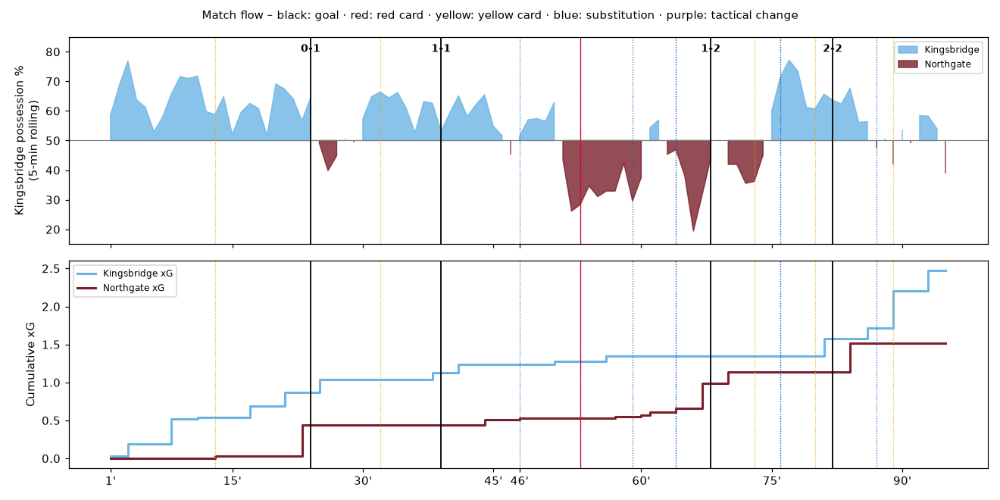
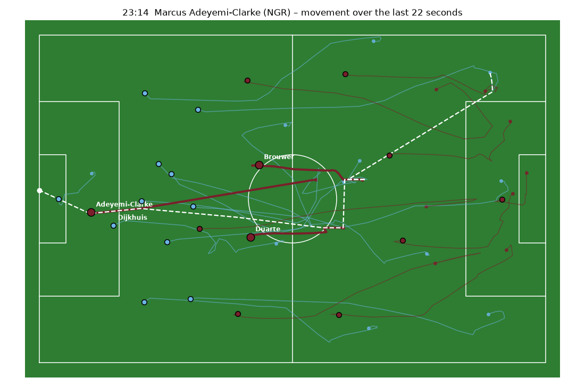
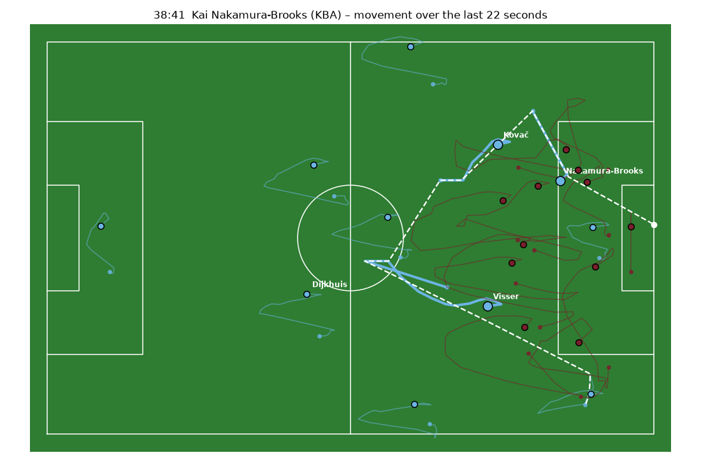
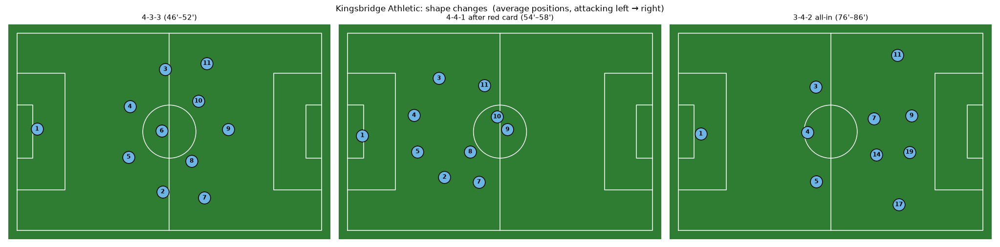
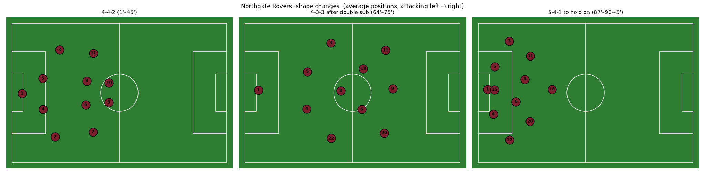
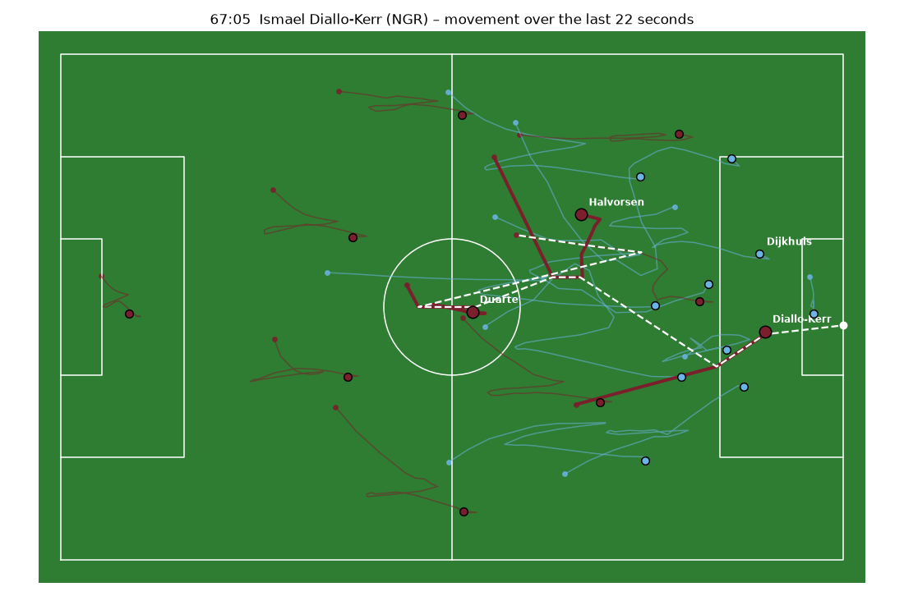
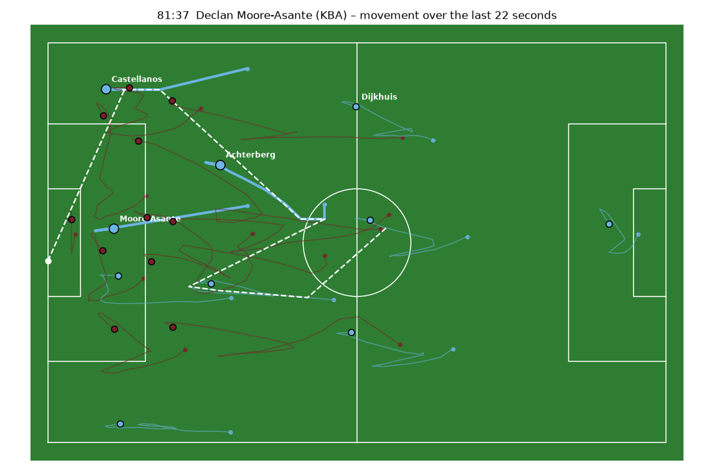

# Match script: Kingsbridge Athletic vs Northgate Rovers

**Synthetic League - Matchday 9 (fictional)** · Kingsbridge Park · 2026-10-24 15:00 · Referee: Alan Ostrowski (fictional) · Dry, 13°C, light wind from the west

**Final score: Kingsbridge Athletic 2 – 2 Northgate Rovers**

> Fully synthetic match. Clubs, players and events are fictional. This script is the source of truth; all data in `output/` is generated from it (`generator/generate_match.py`) and every number below is measured from that data.

## Storyline

A possession side against a counter-attacking side. Kingsbridge dominate the ball early but their slow centre-back is exposed by Northgate's sprinter. A booked Northgate full-back becomes the target of the equaliser. Kingsbridge's hot-headed holding midfielder collects a second yellow, Northgate use the extra man with a switch to 4-3-3 and go ahead, and Kingsbridge go all-in with a back three and a target man to rescue a point.

The full analysis of this match along the 12 components of football analysis is in [MATCH_ANALYSIS.md](MATCH_ANALYSIS.md).

## Pre-match context

- **Venue:** Kingsbridge Park (natural grass, good, slightly firm), 21,400 spectators.
- **Weather:** Dry, 13°C, light wind (11 km/h) from the west. No significant impact. A dry, firm pitch slightly favours fast ball circulation and the Kingsbridge passing game.
- **Referee:** Alan Ostrowski (fictional): Plays advantage a lot, lets physical duels go, strict on simulation and on tactical fouls that stop counter-attacks. (4.6 yellows and 23.1 fouls per game).
- **Stakes:** Matchday 9. Kingsbridge (4th) need a win to stay in touch with the top three. Northgate (9th) are unbeaten in four away games and would be happy with a point.
- **Schedule Kingsbridge:** 3 days rest. Previous match: Cup round 3 away at Pellham Town on Wednesday, won on penalties after 120 minutes. Travel: home match. Load: high: 120 minutes three days ago, six starters played the full match.
- **Schedule Northgate:** 6 days rest. Previous match: League match on Saturday (1-1 vs Eastmoor United). Travel: 210 km by coach, arrived the evening before. Load: normal.
- **Head to head:** Kingsbridge 2-1 Northgate (Northgate scored on the counter; Kingsbridge won with a late set-piece header); Northgate 0-0 Kingsbridge (Kingsbridge 71% possession, 0.9 xG against a low block).

### Kingsbridge Athletic: 4th, 17 points (W5 D2 L1, goals 16-8)

| MD | Opponent (rank) | H/A | Score | xG | xGA | Poss. | Set-piece xG | Note |
|---|---|---|---|---|---|---|---|---|
| 8 | Harlow Bay (15) | A | 3-0 W | 2.6 | 0.5 | 68% | 0.4 | Dominant, scored twice from the counter-press |
| 7 | Redcliffe City (2) | H | 1-1 D | 1.4 | 1.6 | 55% | 0.2 | Conceded on a ball in behind the high line |
| 6 | Oldmere Athletic (18) | H | 2-0 W | 2.1 | 0.3 | 72% | 0.6 | Both goals from corners |
| 5 | Westbrook Albion (6) | A | 2-1 W | 1.7 | 1.2 | 58% | 0.1 | Late winner after switching to a back three |
| 4 | Saltmarsh FC (12) | H | 0-0 D | 1.1 | 0.4 | 74% | 0.3 | Could not break down a low 5-4-1 block |
| 3 | Greystone Rovers (9) | A | 3-2 W | 2.3 | 1.9 | 61% | 0.2 | Brannigan sent off in the 70th minute while 2-1 down |
| 2 | Fenwick Town (3) | A | 1-3 L | 1.3 | 2.2 | 57% | 0.1 | Three goals conceded in transition |
| 1 | Dunmore United (14) | H | 4-1 W | 2.9 | 0.8 | 66% | 0.5 | Kovač two assists |

- **Absent:** Rasmus Holt (CB): Hamstring injury, out for 3 weeks. Holt is the fastest centre-back in the squad and normally covers for Dijkhuis. Without him the pairing is slower and the high line is riskier.
- **Absent:** Jonah Ekwueme (W): Ill. One less attacking option on the bench.
- **Mental:** Confident: 4 wins and 2 draws in the last 6. Expected to win at home. Struggle emotionally when behind: 2 red cards this season, both while trailing. Good at home, nervous when chasing a result late.
- **Coach Ingrid Solberg:** Proactive possession coach. First substitution on average at 58'. When trailing: Goes to a back three with wing-backs and an extra striker (done 3 times this season, one winner). When leading: Keeps the ball, rarely drops deep.
- **Game plan:** Dominate the ball, high press on Northgate's weak build-up, overload the left side through Kovač and Nakamura-Brooks, keep Brannigan as the anchor.
- **Bench (72/100):** A clear plan B in target man Moore-Asante and crossing wing-back Castellanos; a strong defensive midfielder (Achterberg). Little creativity apart from Eriksen.
- **Build-up:** Back three in build-up: Mbeki inverts next to Brannigan, Okafor-Hale stays high. Goalkeeper used as an extra passer, 85% short goal kicks.
- **Pressing:** High press, man-oriented in Northgate's half. Triggers: back pass to the goalkeeper, pass to a full-back near the touchline, bad first touch.
- **Defending:** line high (about 45 m from own goal when in possession), marking zonal in open play, target compactness 30 m.
- **Attacking patterns:** Left-side overload: Kovač in the left half-space, Mbeki inverting, Nakamura-Brooks 1v1; El-Haddad isolation on the right; Lindqvist runs to the near post; Visser late runs into the box.
- **Known weaknesses:** Space behind the high line; Rest defence with only two centre-backs when the full-backs push on; Struggles against low blocks (0-0 vs Saltmarsh); Discipline of the holding midfielder.
- **Set pieces:** corners in-swinging to the near post (takers: Elias Kovač, Samir El-Haddad), 25% short; direct free kicks: Elias Kovač; penalties: Oscar Lindqvist; long throws: none; defending corners: zonal (six in zones, two on man); average outfield height 180 cm. Dangerous from corners at home; Ferreira-Lind is weak on high balls into a crowded box.

### Northgate Rovers: 9th, 12 points (W3 D3 L2, goals 10-10)

| MD | Opponent (rank) | H/A | Score | xG | xGA | Poss. | Set-piece xG | Note |
|---|---|---|---|---|---|---|---|---|
| 8 | Eastmoor United (11) | H | 1-1 D | 0.9 | 1.3 | 44% | 0.3 | Equaliser in the 88th minute conceded from a cross |
| 7 | Pellham Town (16) | A | 2-0 W | 1.6 | 0.7 | 39% | 0.5 | Long throw → header, counter-attack |
| 6 | Fenwick Town (3) | A | 1-1 D | 0.8 | 1.9 | 33% | 0.1 | Saarinen eight saves |
| 5 | Brackwater FC (10) | H | 0-2 L | 1.0 | 1.4 | 51% | 0.2 | Struggled when they had to make the game themselves |
| 4 | Westbrook Albion (6) | A | 2-1 W | 1.2 | 1.5 | 36% | 0.1 | Two counter-attack goals from Adeyemi-Clarke |
| 3 | Redcliffe City (2) | H | 0-3 L | 0.6 | 2.4 | 41% | 0.0 | Pressed into mistakes in their own build-up |
| 2 | Oldmere Athletic (18) | A | 3-1 W | 2.0 | 0.6 | 47% | 0.7 | Two set-piece goals |
| 1 | Saltmarsh FC (12) | H | 1-1 D | 1.1 | 1.0 | 45% | 0.4 | - |

- **Absent:** Stefan Varga (CB): Knee injury, out for 6 weeks. First-choice centre-back and organiser. Okoro is now the only aerial back-up for the 5-4-1.
- **Mental:** Resilient underdog, unbeaten in four away games, good at defending a lead. Rarely come back from behind (1 point from losing positions). Calm under pressure, but they fade late: 5 of their 10 goals conceded came after the 75th minute.
- **Coach Darren Kowalczyk:** Reactive, transition-focused coach. First substitution on average at 66'. When trailing: Brings on an extra striker but keeps the 4-4-2. When leading: Goes to a 5-4-1 with an extra centre-back (done 4 times this season).
- **Game plan:** Stay compact in a 4-4-2 mid/low block, jump on passes into Kingsbridge's holding midfielder, then hit Adeyemi-Clarke early in behind the high line. Avoid playing out from the back against the press.
- **Bench (66/100):** Halvorsen (creative midfielder) and Diallo-Kerr (pace) can change a game; Okoro for defending a lead. Little depth at full-back.
- **Build-up:** Back four in build-up, mostly long: goal kicks long to Petrov (70%). Saarinen is weak with his feet.
- **Pressing:** Mid/low block in a 4-4-2. Trigger: a pass into Kingsbridge's holding midfielder → the nearest striker and central midfielder jump.
- **Defending:** line mid/low (about 32 m from own goal), marking zonal with man-marking in the box, target compactness 25 m.
- **Attacking patterns:** Early long ball in behind for Adeyemi-Clarke; Duarte switches from deep; Lindgren carries the ball on the counter; Long throws and set pieces.
- **Known weaknesses:** Build-up under a high press; Right-back vulnerable 1v1 against pace; Fading physically late in games; Little control when they have to make the game.
- **Set pieces:** corners out-swinging to the far post (takers: Rafael Duarte), 10% short; direct free kicks: Rafael Duarte; penalties: Marcus Adeyemi-Clarke; long throws: Finn Gallagher; defending corners: man-marking; average outfield height 184 cm. Strong in the air thanks to Hollander, Petrov and Okoro. Achebe-Ward regularly loses his man at set pieces. Gallagher's long throws are a real weapon.

### Player profiles (age, height, foot, form, confidence)

| Player | Team | Age | Height | Foot | Form last 5 | Confidence | Pressure handling | Fitness |
|---|---|---|---|---|---|---|---|---|
| Tomás Ferreira-Lind | KBA | 29 | 188 | R | 6.9 | 70 | 82 | fit |
| Jayden Okafor-Hale | KBA | 24 | 177 | R | 7.0 | 74 | 68 | played 120 min midweek |
| Marten Dijkhuis | KBA | 31 | 191 | R | 7.1 | 76 | 86 | played 120 min midweek |
| Callum Reyes | KBA | 26 | 186 | L | 6.9 | 72 | 70 | fit |
| Idris Mbeki | KBA | 27 | 179 | L | 7.0 | 72 | 74 | played 120 min midweek |
| Luca Brannigan | KBA | 28 | 183 | R | 7.2 | 70 | 52 | played 120 min midweek |
| Noah Visser | KBA | 25 | 180 | R | 7.0 | 75 | 76 | played 120 min midweek |
| Elias Kovač | KBA | 27 | 174 | L | 7.6 | 85 | 84 | fit |
| Samir El-Haddad | KBA | 23 | 172 | L | 6.7 | 66 | 60 | fit |
| Oscar Lindqvist | KBA | 26 | 182 | R | 7.3 | 80 | 80 | played 120 min midweek |
| Kai Nakamura-Brooks | KBA | 22 | 175 | R | 7.4 | 82 | 74 | fit |
| Ben Hartley | KBA | 33 | 190 | R | – | 60 | 70 | fit |
| Niels Vanderbeek | KBA | 30 | 192 | R | 6.5 | 60 | 72 | fit |
| Felix Achterberg | KBA | 29 | 185 | R | 6.8 | 68 | 74 | fit |
| Ruben Castellanos | KBA | 21 | 176 | R | 6.9 | 72 | 70 | fit |
| Declan Moore-Asante | KBA | 30 | 195 | R | 6.8 | 70 | 78 | fit |
| Mats Eriksen | KBA | 24 | 178 | R | 6.6 | 64 | 76 | fit |
| Theo Marchetti | KBA | 26 | 180 | L | 6.5 | 62 | 70 | fit |
| Henrik Saarinen | NGR | 32 | 192 | R | 7.5 | 80 | 84 | fit |
| Mateo Quiroga | NGR | 25 | 178 | R | 6.5 | 62 | 60 | fit |
| Bram Hollander | NGR | 30 | 193 | R | 7.1 | 72 | 80 | fit |
| Desmond Achebe-Ward | NGR | 24 | 186 | L | 6.8 | 70 | 72 | fit |
| Finn Gallagher | NGR | 28 | 181 | L | 6.9 | 70 | 74 | fit |
| Jules Moreau | NGR | 27 | 177 | R | 6.8 | 68 | 70 | fit |
| Yannick Brouwer | NGR | 29 | 184 | R | 7.0 | 72 | 72 | fit |
| Rafael Duarte | NGR | 31 | 179 | R | 7.2 | 74 | 84 | fit |
| Theo Lindgren | NGR | 24 | 176 | L | 6.7 | 66 | 58 | fit |
| Marcus Adeyemi-Clarke | NGR | 25 | 180 | R | 7.5 | 82 | 80 | fit |
| Jonas Petrov | NGR | 29 | 189 | R | 6.8 | 68 | 76 | fit |
| Olli Rautio | NGR | 27 | 189 | L | – | 60 | 70 | fit |
| Aaron Whitfield | NGR | 30 | 183 | R | 6.7 | 66 | 74 | fit |
| Lewis Okoro | NGR | 27 | 196 | R | 6.6 | 64 | 74 | fit |
| Viktor Halvorsen | NGR | 23 | 178 | R | 7.1 | 74 | 78 | fit |
| Ismael Diallo-Kerr | NGR | 21 | 179 | R | 6.9 | 70 | 68 | fit |
| Sam Achterhuis | NGR | 26 | 182 | R | 6.5 | 62 | 72 | fit |
| Callan Brierley | NGR | 28 | 188 | R | 6.4 | 60 | 70 | fit |

### Key match-ups (pre-match expectation)

| # | Match-up | Kingsbridge side | Northgate side | Expectation | Favours |
|---|---|---|---|---|---|
| M1 | High line vs elite pace | Kingsbridge's high defensive line with slow Dijkhuis | Adeyemi-Clarke (pace 95) running in behind | Northgate's best route to goal. Each ball over the top is a big chance. | away |
| M2 | Fast winger vs vulnerable right-back | Nakamura-Brooks (pace 92, dribbling 86) | Quiroga (weak 1v1, rash fouls) | Kingsbridge will target their left flank; card risk for Quiroga. | home |
| M3 | High press vs weak build-up | Kingsbridge high press and counter-press | Saarinen's poor distribution, Northgate's long build-up | Kingsbridge win the ball high up; Northgate avoid playing out and go long. | home |
| M4 | Creator between the lines vs compact block | Kovač in the pockets | Northgate's compact 4-4-2 (about 25 m between lines) | Little space for Kovač; Kingsbridge depend on width and crosses. | away |
| M5 | Hot-headed anchor vs counter-attacks | Brannigan (discipline 38) stopping counters | Northgate's fast transitions | Brannigan will have to commit fouls to stop counters. Card risk is high with a strict referee. | away |
| M6 | Set pieces: zonal Kingsbridge vs aerial Northgate | Kingsbridge zonal defending, keeper weak on crosses | Northgate aerial strength and Gallagher's long throws | Set pieces are Northgate's second route to goal. At the other end Achebe-Ward's marking is a target. | even |
| M7 | Late fatigue | Kingsbridge: 120 minutes three days ago, strong bench | Northgate fade late (5/10 goals conceded after 75') | Both sides tire. Whoever's bench brings fresh energy decides the final 20 minutes. | even |

What actually happened in each match-up is measured in MATCH_ANALYSIS.md, section 10.

## Kingsbridge Athletic (home)

**Coach:** Ingrid Solberg · **Starting formation:** 4-3-3

Possession and positional play. High defensive line, aggressive counter-press, full-backs push high. Strength: controlling the ball and the tempo. Weakness: space behind a high line, and a slow right centre-back.

Style parameters: press 0.75, line height +6 m, tempo 0.55, width 1.15, directness 0.35.

### Starting XI

| # | Player | Pos | Pace | Pass | Drib | Fin | Tack | Disc | Stam | Strengths | Weaknesses |
|---|---|---|---|---|---|---|---|---|---|---|---|
| 1 | Tomás Ferreira-Lind | GK | 52 | 78 | 40 | 10 | 20 | 90 | 70 | Calm with the ball at his feet, an extra passer in the build-up; Good positioning, sweeps behind the high line | Average shot-stopper on close-range efforts; Struggles with high crosses into a crowded box |
| 2 | Jayden Okafor-Hale | RB | 84 | 72 | 74 | 45 | 66 | 78 | 88 | Tireless overlapping runs; Quick recovery sprints | Positionally loose when the ball is on the far side; Crosses are inconsistent |
| 5 | Marten Dijkhuis | RCB | 58 | 80 | 50 | 35 | 82 | 82 | 74 | Dominant in the air; Captain and organiser, line-breaking passes from the back | Lacks pace: vulnerable to runs in behind a high line; Turns slowly |
| 4 | Callum Reyes | LCB | 76 | 70 | 55 | 30 | 80 | 80 | 78 | Quick cover defender; Strong one-on-one | Limited passing range under pressure; Sometimes steps out too early |
| 3 | Idris Mbeki | LB | 80 | 74 | 70 | 40 | 74 | 84 | 82 | Inverts into midfield in possession; Disciplined defender | Rarely beats a man on the outside; Weaker on his right foot |
| 6 | Luca Brannigan | DM | 66 | 86 | 68 | 50 | 84 | 38 | 84 | Excellent passing range, dictates the tempo; Wins the ball back quickly in the counter-press | Hot-headed: high foul rate, poor discipline; Loses composure when the team is behind |
| 8 | Noah Visser | RCM | 74 | 78 | 72 | 62 | 74 | 80 | 94 | Box-to-box engine, covers the most ground; Late runs into the box | Final pass sometimes rushed; Not a natural holding midfielder |
| 10 | Elias Kovač | LCM | 70 | 90 | 84 | 72 | 48 | 80 | 62 | Creator: most key passes in the team; Finds pockets between the lines | Low defensive work rate; Fades physically after the hour |
| 7 | Samir El-Haddad | RW | 88 | 72 | 88 | 70 | 40 | 74 | 76 | Explosive dribbler in one-on-ones; Cuts inside on his left foot | Poor decision-making in the final third; Gives the ball away under pressure |
| 9 | Oscar Lindqvist | ST | 78 | 66 | 72 | 86 | 38 | 82 | 76 | Clinical first-time finisher; Smart movement across the front post | Weak hold-up play with his back to goal; Not dominant in aerial duels |
| 11 | Kai Nakamura-Brooks | LW | 92 | 74 | 86 | 78 | 42 | 84 | 80 | Fastest player on the pitch; Cuts in onto his right foot to curl shots | Drifts out of games when doubled up; Little defensive contribution |

### Substitutes

| # | Player | Pos | Pace | Pass | Drib | Fin | Tack | Disc | Stam | Strengths | Weaknesses |
|---|---|---|---|---|---|---|---|---|---|---|---|
| 12 | Ben Hartley | GK | 50 | 60 | 35 | 10 | 20 | 90 | 70 | Strong reflex saves | Weak with his feet |
| 15 | Niels Vanderbeek | CB | 64 | 66 | 45 | 30 | 80 | 76 | 76 | Aerially strong; Simple, safe passing | Slow on the turn |
| 14 | Felix Achterberg | DM | 68 | 74 | 60 | 45 | 86 | 66 | 86 | Pure destroyer: screens the back four; Reads danger early | Limited creativity going forward; Takes tactical fouls (card risk) |
| 17 | Ruben Castellanos | RWB | 86 | 76 | 78 | 55 | 58 | 80 | 84 | Excellent crosser from deep and from the byline; Fresh legs for a wing-back role | Defensively naive; Leaves space behind him |
| 19 | Declan Moore-Asante | ST | 62 | 60 | 55 | 80 | 45 | 72 | 72 | Target man: wins almost every aerial duel; Dangerous header from crosses | Slow, no threat in behind; Little involvement in combination play |
| 16 | Mats Eriksen | CM | 70 | 80 | 70 | 60 | 66 | 82 | 82 | Tidy ball circulation | Lacks physical presence |
| 18 | Theo Marchetti | LB | 78 | 68 | 66 | 38 | 72 | 84 | 80 | Reliable back-up full-back | Offers little going forward |

## Northgate Rovers (away)

**Coach:** Darren Kowalczyk · **Starting formation:** 4-4-2

Compact 4-4-2 mid/low block and fast transitions. Win the ball in midfield, play early long balls for a very quick striker. Strength: counter-attacks and defensive organisation. Weakness: little control in possession, a right-back who is vulnerable one-on-one.

Style parameters: press 0.45, line height -4 m, tempo 0.7, width 1.0, directness 0.7.

### Starting XI

| # | Player | Pos | Pace | Pass | Drib | Fin | Tack | Disc | Stam | Strengths | Weaknesses |
|---|---|---|---|---|---|---|---|---|---|---|---|
| 1 | Henrik Saarinen | GK | 50 | 55 | 30 | 10 | 20 | 88 | 70 | Outstanding shot-stopper; Commands his box on crosses | Poor distribution, long kicks rarely find a team-mate; Hesitant when coming off his line |
| 2 | Mateo Quiroga | RB | 72 | 72 | 70 | 40 | 62 | 64 | 82 | Good crosser on the overlap; Links up well with the right midfielder | Vulnerable one-on-one against fast wingers; Commits rash fouls when beaten |
| 4 | Bram Hollander | RCB | 62 | 66 | 45 | 35 | 84 | 80 | 78 | Aerial dominance in his own box; Blocks shots | Slow over the first metres; Uncomfortable playing out from the back |
| 5 | Desmond Achebe-Ward | LCB | 84 | 68 | 55 | 30 | 82 | 82 | 80 | Recovery pace; Aggressive in stepping out to intercept | Loses his marker at set pieces |
| 3 | Finn Gallagher | LB | 76 | 68 | 62 | 35 | 78 | 82 | 84 | Solid, positionally disciplined defender | Offers little in the final third |
| 7 | Jules Moreau | RM | 80 | 70 | 72 | 60 | 70 | 82 | 90 | Huge work rate, tracks back; Supports counters at speed | Final ball lacks quality; Tires after the hour from all the defending |
| 6 | Yannick Brouwer | RCM | 68 | 70 | 60 | 50 | 88 | 60 | 88 | Ball-winner: most tackles and interceptions; Triggers the counter | Limited passing range; Picks up yellows for tactical fouls |
| 8 | Rafael Duarte | LCM | 64 | 88 | 72 | 58 | 66 | 84 | 78 | Deep-lying playmaker: long balls over the top; Calm under pressure | Slow to track runners; Struggles against a high press |
| 11 | Theo Lindgren | LM | 82 | 70 | 82 | 66 | 50 | 58 | 78 | Tricky dribbler, draws fouls; Carries the ball on the counter | Goes to ground too easily; Inconsistent defensive tracking |
| 9 | Marcus Adeyemi-Clarke | RS | 95 | 62 | 78 | 84 | 40 | 80 | 74 | Elite sprint speed, runs in behind; Composed one-on-one finisher | Isolated when the team has the ball for long spells; Prone to cramp late in matches |
| 10 | Jonas Petrov | LS | 66 | 76 | 70 | 72 | 52 | 82 | 80 | Hold-up play, brings others into the game; Wins long balls | Not a goal-scorer; Slow to press |

### Substitutes

| # | Player | Pos | Pace | Pass | Drib | Fin | Tack | Disc | Stam | Strengths | Weaknesses |
|---|---|---|---|---|---|---|---|---|---|---|---|
| 16 | Olli Rautio | GK | 50 | 62 | 30 | 10 | 20 | 88 | 70 | Better distribution than the starter | Less agile |
| 22 | Aaron Whitfield | RB | 80 | 64 | 58 | 30 | 82 | 84 | 80 | Defensive full-back, strong one-on-one; Fast enough to stay with wingers | Offers almost nothing going forward |
| 15 | Lewis Okoro | CB | 66 | 60 | 42 | 30 | 82 | 80 | 76 | Aerial specialist, brought on against crosses | Slow and limited on the ball |
| 18 | Viktor Halvorsen | AM | 74 | 86 | 82 | 70 | 50 | 82 | 80 | Through-balls into the channels; Finds space between the lines | Not built to defend for long spells |
| 20 | Ismael Diallo-Kerr | FW | 90 | 66 | 84 | 80 | 44 | 78 | 80 | Quick wide forward, attacks the space behind full-backs; Dangerous against tired legs | Disappears in tight spaces; Wasteful with his first touch |
| 14 | Sam Achterhuis | CM | 66 | 72 | 62 | 50 | 76 | 80 | 84 | Reliable squad midfielder | Few standout qualities |
| 17 | Callan Brierley | FW | 72 | 62 | 66 | 74 | 40 | 80 | 76 | Physical striker | Lacks pace |

## Match phases

| Minutes | Phase | Target possession KBA | Measured possession KBA | What happens |
|---|---|---|---|---|
| 0–23 | Kingsbridge in control | 65% | 67% | Kingsbridge build patiently through Brannigan and Kovač, full-backs high, counter-press straight after losing the ball. Northgate sit in a compact 4-4-2 and look for Adeyemi-Clarke early. |
| 23–38 | Shock and frustration | 62% | 52% | After the 0-1 Kingsbridge push even higher and play faster, which leads to more turnovers. Brannigan's frustration grows; Northgate defend deep and keep threatening on the break. |
| 38–52 | Back on terms | 58% | 58% | The equaliser settles Kingsbridge. After the break Northgate's new right-back closes the left flank, so Kingsbridge attack more down the right through El-Haddad. |
| 52–63 | Ten men | 46% | 40% | Brannigan's red card removes Kingsbridge's tempo-setter. They drop into a 4-4-1 and lose control of midfield; Northgate get more of the ball than they are used to. |
| 63–75 | Northgate exploit the extra man | 38% | 36% | Northgate switch to 4-3-3 and overload the central zone where Kingsbridge are a man short. The space between the lines that Brannigan used to protect is now open. |
| 75–86 | All in | 57% | 68% | Kingsbridge go to a back three with wing-backs and a target man. Lots of crosses, lots of territory, but huge spaces behind them for Northgate's counters. |
| 86–96 | Holding on | 62% | 53% | Northgate bring on an extra centre-back and sit in a 5-4-1 to protect the point. Kingsbridge bombard the box; the match ends with a last header saved by Saarinen. |

## Minute-by-minute script

Every scripted moment, in order. Unscripted play (passes, duels, other shots, set pieces) is filled in by the generator.

### 08:12 Chance Kingsbridge – saved (xG 0.18)

Kovač finds Lindqvist between the lines; first-time shot pushed wide by Saarinen. Shows Kingsbridge's main route: Brannigan → Kovač → Lindqvist through the centre.

### 12:40 🟨 YELLOW: Mateo Quiroga (Northgate)

**Reason:** Tactical foul: pulls Nakamura-Brooks back by the shirt after being beaten for pace.

**Effect on the player and the match:** Quiroga can no longer risk going into duels. He stands off Nakamura-Brooks (about 4 m deeper) and loses more one-on-ones. Kingsbridge recognise the weak spot and play noticeably more balls down their left flank.

*Model parameters:* duel aggression × 0.55, foul rate × 0.5, position shift (m) -4, duel win chance − 0.12, opponents target his zone × 2.5.

*Data check:* relative to the other Northgate defenders, Quiroga's average position went from +5.0 m to +2.4 m (negative = deeper). Share of Kingsbridge passes into the opponent's half that went to their left flank: 24% before → 48% after the card.

### 23:14 ⚽ GOAL Northgate: Marcus Adeyemi-Clarke (assist Rafael Duarte)

*Pattern:* counter attack · *xG:* 0.41 · *Body part:* right foot

Brouwer intercepts Kovač's pass, Duarte plays the ball over the high line in one touch, and Adeyemi-Clarke outruns Dijkhuis and slots it in at the near post. 0-1.

**Why it matters:** Textbook use of Kingsbridge's weak spot: a high line with a slow centre-back against the fastest striker on the pitch (see the data check for where the line was when the ball was played).

*Data check:* when Duarte played the ball (23:08), Dijkhuis stood 35 m from his own goal. At the moment of the shot he was 5 m away from Adeyemi-Clarke.

### 31:05 🟨 YELLOW: Luca Brannigan (Kingsbridge)

**Reason:** Late sliding tackle on Adeyemi-Clarke out of frustration after a lost ball.

**Effect on the player and the match:** Brannigan barely adjusts (low discipline rating): he still goes into duels and still counter-presses. The coaching staff note the risk but keep him on because he is their key passer.

*Model parameters:* duel aggression × 0.85, foul rate × 0.85, position shift (m) -2, duel win chance − 0.05.

### 38:41 ⚽ GOAL Kingsbridge: Kai Nakamura-Brooks (assist Elias Kovač)

*Pattern:* isolation cut inside · *xG:* 0.09 · *Body part:* right foot

Kovač switches the play to Nakamura-Brooks, who attacks the booked Quiroga, cuts inside onto his right foot and curls it into the far corner. 1-1.

**Why it matters:** A direct result of the 12th-minute yellow card: Quiroga stood off and gave Nakamura-Brooks room to shoot. A low-xG chance (0.09) finished by individual quality.

### 44:30 Chance Northgate – off target (xG 0.07)

Lindgren carries on the counter, Petrov shoots over from the edge of the box. Northgate stay dangerous on the break, even with little of the ball.

### 45:00 🔁 Substitution Northgate: Aaron Whitfield on, Mateo Quiroga off

**Reason:** Quiroga is on a yellow and was beaten repeatedly by Nakamura-Brooks; a second yellow was only a matter of time.

**Formation:** 4-4-2 (system unchanged)

**What it means for the game:** No change in system, but a different profile: Whitfield is a pure defender. Northgate's right flank no longer supports attacks (fewer overlaps), and Nakamura-Brooks wins far fewer duels. Kingsbridge stop targeting that side and shift their attacks to the right through El-Haddad.

*Data check:* Kingsbridge passes into the final half towards the left flank: 48% (12'–45') → 25% (46'–52'); to the right: 23% → 50%.

### 52:18 🟥 SECOND YELLOW → RED: Luca Brannigan (Kingsbridge)

**Reason:** Second yellow: trips Adeyemi-Clarke as he breaks through midfield on the counter. Off he goes.

**Effect on the player and the match:** Kingsbridge are down to 10 men and lose their tempo-setter and main ball-winner.

**Impact on the team (measured):**

| Kingsbridge | 10 min before | 10 min after |
|---|---|---|
| Possession % | 47 | 44 |
| Passes | 49 | 30 |
| Pass accuracy % | 82 | 80 |
| Shots (for/against) | 1 / 2 | 1 / 3 |
| xG (for/against) | 0.03 / 0.09 | 0.08 / 0.08 |
| Crosses | 1 | 0 |
| Tackles + interceptions | 2 | 4 |
| Defensive line (m from own goal) | 40.0 | 26.3 |
| Team width (m) | 44.4 | 33.2 |

### 52:50 📋 Tactical change Kingsbridge: 4-4-1

**Reason:** Forced reshape after the red card.

**What it means for the game:** From 4-3-3 to 4-4-1: the wingers drop back to midfield, the line drops about 6 m and the high press is mostly abandoned. Lindqvist is isolated up front. Expected effect: possession falls from about 58% to about 45%, and Kingsbridge rely more on counters through Nakamura-Brooks.

### 58:30 🔁 Substitution Kingsbridge: Felix Achterberg on, Elias Kovač off

**Reason:** Kovač is tired and does little defensively; with 10 men the centre has to be closed.

**Formation:** 4-4-1 (tactical change)

**What it means for the game:** Same system, different balance: Achterberg sits in front of the defence, Visser moves to the left of midfield. The centre is tighter, but Kingsbridge lose their creator, so fewer key passes and even less possession. They now play to avoid losing rather than to win.

**Impact (measured, 10 minutes before vs. after):**

| Kingsbridge | 10 min before | 10 min after |
|---|---|---|
| Possession % | 30 | 44 |
| Passes | 26 | 38 |
| Pass accuracy % | 77 | 79 |
| Shots (for/against) | 2 / 1 | 0 / 4 |
| xG (for/against) | 0.11 / 0.02 | 0.00 / 0.44 |
| Crosses | 0 | 0 |
| Tackles + interceptions | 4 | 6 |
| Defensive line (m from own goal) | 32.7 | 24.5 |
| Team width (m) | 37.0 | 35.5 |

### 63:20 🔁 Substitution Northgate: Viktor Halvorsen on, Jules Moreau off

**Reason:** Moreau is tired after an hour of defending; Northgate want more quality on the ball.

**Formation:** 4-3-3-deep (tactical change)

**What it means for the game:** Double substitution plus a switch from 4-4-2 to 4-3-3: three central midfielders against Kingsbridge's two, with Halvorsen in the pocket where Brannigan used to be. Northgate move from reacting to controlling; their press goes up and the line moves about 7 m higher.

### 63:20 🔁 Substitution Northgate: Ismael Diallo-Kerr on, Jonas Petrov off

**Reason:** Petrov's hold-up play matters less now that Northgate have more of the ball; Diallo-Kerr brings pace against tiring legs.

**Formation:** 4-3-3-deep (tactical change)

**What it means for the game:** Part of the switch to 4-3-3: Diallo-Kerr plays on the right and attacks the space behind Mbeki.

**Impact (measured, 10 minutes before vs. after):**

| Northgate | 10 min before | 10 min after |
|---|---|---|
| Possession % | 55 | 66 |
| Passes | 35 | 51 |
| Pass accuracy % | 86 | 88 |
| Shots (for/against) | 3 / 1 | 3 / 0 |
| xG (for/against) | 0.08 / 0.08 | 0.53 / 0.00 |
| Crosses | 3 | 1 |
| Tackles + interceptions | 3 | 5 |
| Defensive line (m from own goal) | 38.4 | 37.3 |
| Team width (m) | 37.8 | 40.7 |

### 67:05 ⚽ GOAL Northgate: Ismael Diallo-Kerr (assist Viktor Halvorsen)

*Pattern:* through ball between lines · *xG:* 0.33 · *Body part:* right foot

Duarte finds Halvorsen unmarked between the lines; his through ball sends Diallo-Kerr in behind Mbeki, and he finishes across Ferreira-Lind. 1-2.

**Why it matters:** The result of the red card and both substitutions combined: Halvorsen receives the ball in exactly the zone a holding midfielder would normally cover. Four minutes after the tactical switch it pays off.

### 72:30 🟨 YELLOW: Theo Lindgren (Northgate)

**Reason:** Simulation: goes down in the box under minimal contact from Okafor-Hale.

**Effect on the player and the match:** Lindgren takes fewer dribbles into the box and passes more. With his credibility gone, the referee will be stricter on him.

*Model parameters:* dribble attempts × 0.7, duel aggression × 0.9.

### 75:00 🔁 Substitution Kingsbridge: Ruben Castellanos on, Jayden Okafor-Hale off

**Reason:** Kingsbridge have to go for it. A wing-back with a better cross replaces the full-back.

**Formation:** 3-4-2 (tactical change)

**What it means for the game:** Switch to a back three with wing-backs and two strikers. Kingsbridge commit numbers forward: 4-5 players in the box on every cross. Downside: only three defenders against Northgate's three attackers, so every turnover is a potential counter.

### 75:00 🔁 Substitution Kingsbridge: Declan Moore-Asante on, Noah Visser off

**Reason:** A target man for aerial balls; Visser is running on empty.

**Formation:** 3-4-2 (tactical change)

**What it means for the game:** Moore-Asante gives Kingsbridge a plan B: crosses. Expect the number of crosses and headed attempts to rise sharply.

**Impact (measured, 10 minutes before vs. after):**

| Kingsbridge | 10 min before | 10 min after |
|---|---|---|
| Possession % | 40 | 68 |
| Passes | 41 | 56 |
| Pass accuracy % | 68 | 80 |
| Shots (for/against) | 0 / 2 | 1 / 1 |
| xG (for/against) | 0.00 / 0.48 | 0.22 / 0.38 |
| Crosses | 0 | 3 |
| Tackles + interceptions | 10 | 6 |
| Defensive line (m from own goal) | 26.0 | 50.9 |
| Team width (m) | 42.0 | 38.1 |

### 79:10 🟨 YELLOW: Yannick Brouwer (Northgate)

**Reason:** Tactical foul: stops El-Haddad on a quick break.

**Effect on the player and the match:** Northgate's ball-winner has to be careful now. Kingsbridge midfielders get more time on the ball in front of the box, so second balls and crosses come in more freely.

*Model parameters:* duel aggression × 0.6, foul rate × 0.5, position shift (m) -3, duel win chance − 0.08.

### 81:37 ⚽ GOAL Kingsbridge: Declan Moore-Asante (assist Ruben Castellanos)

*Pattern:* cross header · *xG:* 0.22 · *Body part:* head

Castellanos gets to the byline and whips in a cross; Moore-Asante beats Hollander in the air and heads it in. 2-2.

**Why it matters:** Both Kingsbridge substitutes combine for the equaliser. Exactly what the 75th-minute switch was for: wing-back crosses for a target man.

### 84:02 Chance Northgate – saved (xG 0.38)

Counter against the back three: Diallo-Kerr runs through alone, Ferreira-Lind saves with his legs. The risk of the 3-4-2 in action: one pass and Northgate are through.

### 86:10 🔁 Substitution Northgate: Lewis Okoro on, Marcus Adeyemi-Clarke off

**Reason:** Adeyemi-Clarke has cramp; Northgate also want an extra centre-back against the aerial bombardment.

**Formation:** 5-4-1 (tactical change)

**What it means for the game:** From 4-3-3 to 5-4-1: Northgate choose the point. Okoro marks Moore-Asante, the line drops deep and the counter threat almost disappears (no fast striker left). Kingsbridge get the territory but face a packed box.

**Impact (measured, 10 minutes before vs. after):**

| Northgate | 10 min before | 10 min after |
|---|---|---|
| Possession % | 42 | 42 |
| Passes | 40 | 22 |
| Pass accuracy % | 68 | 73 |
| Shots (for/against) | 1 / 1 | 0 / 5 |
| xG (for/against) | 0.38 / 0.22 | 0.00 / 0.91 |
| Crosses | 0 | 0 |
| Tackles + interceptions | 16 | 11 |
| Defensive line (m from own goal) | 14.6 | 9.3 |
| Team width (m) | 38.0 | 35.2 |

### 88:20 🟨 YELLOW: Felix Achterberg (Kingsbridge)

**Reason:** Tactical foul: drags down Diallo-Kerr to stop a 3-on-2 counter.

**Effect on the player and the match:** A 'professional' yellow: little effect this late in the game, but Achterberg can't afford another tackle.

*Model parameters:* duel aggression × 0.6, foul rate × 0.5.

### 90+3:10 Chance Kingsbridge – saved (xG 0.2)

Last chance: Nakamura-Brooks crosses, Moore-Asante's header is tipped over by Saarinen. Northgate's 5-4-1 holds, partly thanks to their goalkeeper.

## Final statistics

| | Kingsbridge | Northgate |
|---|---|---|
| Goals | 2 | 2 |
| Possession % | 57.4 | 42.6 |
| Passes | 487 | 374 |
| Pass accuracy % | 83.6 | 81.6 |
| Shots | 19 | 11 |
| Shots on target | 7 | 4 |
| xG | 2.48 | 1.52 |
| Corners | 7 | 4 |
| Crosses | 23 | 5 |
| Fouls | 12 | 8 |
| Yellow cards | 3 | 3 |
| Red cards | 1 | 0 |
| Offsides | 4 | 2 |
| Tackles | 51 | 52 |
| Interceptions | 11 | 28 |
| Distance covered (km) | 106.26 | 102.76 |

## Player statistics

| Team | # | Player | Min | Km | Sprints | Top km/h | Passes (acc %) | Shots | xG | G | A | Tackles won/att | Int | Fouls | Cards |
|---|---|---|---|---|---|---|---|---|---|---|---|---|---|---|---|
| KBA | 1 | Tomás Ferreira-Lind | 97 | 3.8 | 0 | 16 | 13 (92) | 0 | 0.00 | 0 | 0 | 0/0 | 0 | 0 |  |
| KBA | 2 | Jayden Okafor-Hale | 77 | 8.5 | 16 | 27 | 31 (81) | 0 | 0.00 | 0 | 0 | 1/2 | 0 | 1 |  |
| KBA | 3 | Idris Mbeki | 97 | 10.4 | 15 | 27 | 23 (87) | 0 | 0.00 | 0 | 0 | 0/0 | 0 | 1 |  |
| KBA | 4 | Callum Reyes | 97 | 8.8 | 7 | 26 | 28 (82) | 0 | 0.00 | 0 | 0 | 6/6 | 0 | 1 |  |
| KBA | 5 | Marten Dijkhuis | 97 | 8.7 | 3 | 26 | 30 (93) | 1 | 0.03 | 0 | 0 | 7/7 | 0 | 1 |  |
| KBA | 6 | Luca Brannigan | 54 | 6.1 | 8 | 24 | 38 (90) | 0 | 0.00 | 0 | 0 | 3/3 | 1 | 2 | 🟨🟨🟥 |
| KBA | 7 | Samir El-Haddad | 97 | 11.5 | 49 | 28 | 61 (77) | 0 | 0.00 | 0 | 0 | 3/4 | 2 | 1 |  |
| KBA | 8 | Noah Visser | 77 | 9.3 | 9 | 26 | 46 (76) | 1 | 0.02 | 0 | 0 | 5/8 | 1 | 1 |  |
| KBA | 9 | Oscar Lindqvist | 97 | 10.8 | 37 | 27 | 44 (86) | 9 | 1.16 | 0 | 0 | 6/7 | 4 | 1 |  |
| KBA | 10 | Elias Kovač | 60 | 7.6 | 9 | 25 | 47 (85) | 1 | 0.05 | 0 | 1 | 2/2 | 0 | 0 |  |
| KBA | 11 | Kai Nakamura-Brooks | 97 | 11.7 | 51 | 30 | 56 (84) | 1 | 0.09 | 1 | 0 | 0/4 | 1 | 1 |  |
| KBA | 14 | Felix Achterberg | 36 | 4.4 | 3 | 25 | 33 (82) | 1 | 0.02 | 0 | 0 | 3/3 | 1 | 1 | 🟨 |
| KBA | 17 | Ruben Castellanos | 20 | 2.8 | 18 | 28 | 21 (86) | 1 | 0.07 | 0 | 1 | 1/2 | 0 | 0 |  |
| KBA | 19 | Declan Moore-Asante | 20 | 2.1 | 9 | 24 | 16 (81) | 4 | 1.03 | 1 | 0 | 3/3 | 1 | 1 |  |
| NGR | 1 | Henrik Saarinen | 97 | 3.5 | 0 | 16 | 11 (54) | 0 | 0.00 | 0 | 0 | 0/0 | 0 | 0 |  |
| NGR | 2 | Mateo Quiroga | 47 | 4.6 | 2 | 24 | 11 (82) | 0 | 0.00 | 0 | 0 | 1/4 | 2 | 2 | 🟨 |
| NGR | 3 | Finn Gallagher | 97 | 9.4 | 4 | 26 | 20 (85) | 0 | 0.00 | 0 | 0 | 2/4 | 4 | 0 |  |
| NGR | 4 | Bram Hollander | 97 | 7.6 | 0 | 22 | 12 (75) | 1 | 0.03 | 0 | 0 | 4/11 | 2 | 0 |  |
| NGR | 5 | Desmond Achebe-Ward | 97 | 7.8 | 9 | 25 | 11 (82) | 0 | 0.00 | 0 | 0 | 2/8 | 2 | 0 |  |
| NGR | 6 | Yannick Brouwer | 97 | 10.6 | 2 | 25 | 51 (84) | 0 | 0.00 | 0 | 0 | 2/4 | 3 | 2 | 🟨 |
| NGR | 7 | Jules Moreau | 65 | 7.1 | 14 | 27 | 35 (80) | 0 | 0.00 | 0 | 0 | 0/1 | 1 | 2 |  |
| NGR | 8 | Rafael Duarte | 97 | 10.3 | 3 | 24 | 43 (88) | 0 | 0.00 | 0 | 1 | 2/4 | 5 | 1 |  |
| NGR | 9 | Marcus Adeyemi-Clarke | 88 | 11.0 | 53 | 28 | 44 (80) | 6 | 0.67 | 1 | 0 | 1/4 | 1 | 1 |  |
| NGR | 10 | Jonas Petrov | 65 | 7.6 | 19 | 25 | 36 (92) | 2 | 0.10 | 0 | 0 | 1/2 | 1 | 0 |  |
| NGR | 11 | Theo Lindgren | 97 | 10.5 | 9 | 27 | 55 (71) | 0 | 0.00 | 0 | 0 | 2/4 | 4 | 0 | 🟨 |
| NGR | 15 | Lewis Okoro | 9 | 0.5 | 1 | 25 | 3 (67) | 0 | 0.00 | 0 | 0 | 1/2 | 0 | 0 |  |
| NGR | 18 | Viktor Halvorsen | 32 | 3.7 | 6 | 26 | 18 (89) | 0 | 0.00 | 0 | 1 | 2/2 | 1 | 0 |  |
| NGR | 20 | Ismael Diallo-Kerr | 32 | 3.8 | 23 | 28 | 14 (86) | 2 | 0.71 | 1 | 0 | 0/1 | 1 | 0 |  |
| NGR | 22 | Aaron Whitfield | 50 | 4.7 | 9 | 26 | 10 (90) | 0 | 0.00 | 0 | 0 | 1/1 | 1 | 0 |  |

## Data files

| File | Contents |
|---|---|
| `script/match_script.json` | This script as data: clubs, players (attributes, strengths, weaknesses), formations, phases, all scripted moments |
| `output/events.json` / `.csv` | Every event (pass, cross, shot, goal, tackle, interception, foul, card, substitution, tactical change, set pieces …) with clock, team, player, start/end position, outcome, xG, possession sequence, score |
| `output/tracking.csv` | 1 frame per second: x/y position and speed of every player on the pitch + ball (with ball holder / live-dead state) |
| `output/stats_per_minute.json` / `.csv` | Per minute and cumulative per team: score, formation, players on pitch, possession, passes, accuracy, shots, on target, xG, corners, crosses, fouls, cards, offsides, tackles, interceptions, distance |
| `output/player_stats.json` / `.csv` | Per player: minutes, distance, sprints, top speed, passes, key passes, shots, xG, goals, assists, duels, fouls, cards |
| `output/player_status.json` | Over time: cards with the effect parameters applied to the player, substitutions, effects of substitutions on opponents |
| `output/tactical_states.json` | Formation and role of every player after each tactical change |
| `script/pre_match_context.json` | Pre-match context: venue, weather, referee, stakes, schedule, form (last 8), absences, mental state, coach profiles, bench, set-piece profiles, structures, player profiles, key match-ups |
| `output/analysis.json` | Full analysis (12 components): per team, per phase, per player, match-ups, coaching |
| `output/morale_timeline.json` | Modelled team confidence per minute and the events that moved it |
| `output/figures/` | Movement lines for every goal, shape changes, match flow, shot map, pass networks, regains, physical load, confidence |
| `MATCH_ANALYSIS.md` | Readable analysis along the 12 components |

**Coordinates:** metres, pitch 105 × 68, origin at the bottom-left corner. Kingsbridge attack towards x = 105 in the first half and towards x = 0 in the second half.

**Regenerate:** `python generator/generate_match.py && python generator/analyze_match.py && python generator/render_analysis.py && python generator/render_draaiboek.py`. Change `meta.seed` for a different version of the unscripted play; the scripted moments and the final score stay the same.

## Model notes and limitations

- Tracking is 1 Hz and generated by a movement model (formation anchors + ball-oriented shifts + pressing + scripted runs), not real optical tracking. Fine for heatmaps, average positions, shape, distance and sprints; too coarse for exact biomechanics.
- Only scripted shots can become goals; the generator never adds an extra goal.
- Card effects work through parameters (aggression, foul rate, depth, duel win chance, how much opponents target the player). The 'data checks' show how strongly this shows up in the data.
- Sprint = a 1-second sample above 23.8 km/h (threshold lowered from the usual 25.2 km/h because 1 Hz averaging flattens peaks). High-intensity run = entering > 19.8 km/h. Top speeds are lower than in real data.
